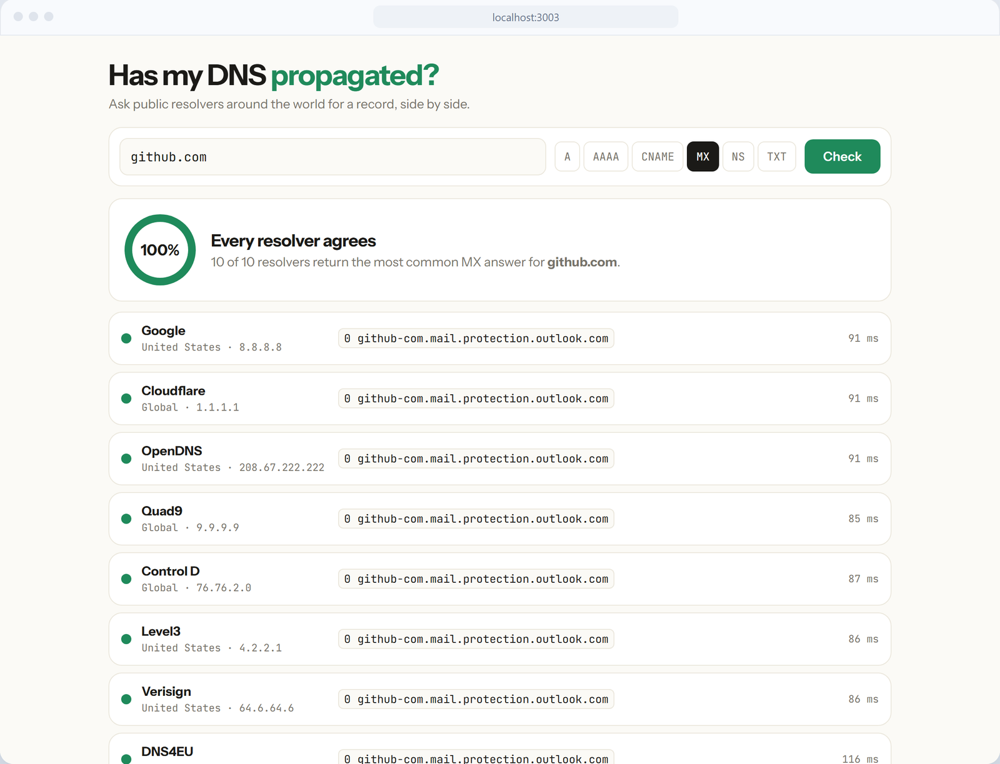

# DNS Propagation Checker | APIVerve Template

[](LICENSE)
[](package.json)
[](tsconfig.json)
[](https://apiverve.com/marketplace/dnspropagation?utm_source=github&utm_medium=template&utm_campaign=dns-propagation-nextjs-tutorial)

A DNS propagation checker you can deploy in one click. Enter a domain, pick a record type, and see what public resolvers around the world return for it, side by side, with a score for how many agree. Use it after changing DNS to see where the change has landed.

[](https://vercel.com/new/clone?repository-url=https%3A%2F%2Fgithub.com%2Fapiverve%2Fdns-propagation-nextjs-tutorial&project-name=dns-propagation&repository-name=dns-propagation&env=APIVERVE_API_KEY&envDescription=Your%20APIVerve%20API%20key.%20Free%20to%20create%2C%20no%20card%20needed.&envLink=https%3A%2F%2Fdashboard.apiverve.com%2Fsignup%3Fapi%3Ddnspropagation%26utm_source%3Dvercel%26utm_medium%3Dtemplate%26utm_campaign%3Ddns-propagation-nextjs-tutorial)



---

### Get your free API key

This template needs an APIVerve API key. **[Sign up free](https://dashboard.apiverve.com/signup?api=dnspropagation&utm_source=github&utm_medium=template&utm_campaign=dns-propagation-nextjs-tutorial)**, no credit card required.

---

## Deploy in one click

Click **Deploy with Vercel** above. Vercel copies this repo to your GitHub account, asks for your `APIVERVE_API_KEY`, and gives you a live URL about a minute later.

## Run it locally

```bash
git clone https://github.com/apiverve/dns-propagation-nextjs-tutorial.git
cd dns-propagation-nextjs-tutorial
npm install
cp .env.example .env   # then set APIVERVE_API_KEY in .env
npm run dev
```

Open `http://localhost:3000`. To see it in a phone and a browser frame side by side, open `http://localhost:3000/showcase.html`.

## How it works

1. `components/DnsApp.tsx` is the page. It calls `/api/check?domain=...&type=...` when you press Check or pick a record type, and `?domain=` and `?type=` in the page address open on any check.
2. `app/api/check/route.ts` checks the input, then calls DNS Propagation. Your API key stays on the server and never reaches the browser. Propagation is about change, so answers are only cached for 2 minutes, and cached answers don't count against the rate limit.
3. The page groups identical answers and gives each group a colour, scores how many resolvers return the most common answer, and lists every resolver with its records.

Everything on the page works on a free key: every resolver's answer for A, AAAA, CNAME, MX, NS and TXT records, and the agreement score. Paid plans add each resolver's response time, shown at the end of its row.

```
app/
  api/check/route.ts   validates the domain and record type, then calls DNS Propagation
  layout.tsx
  page.tsx
  globals.css
components/
  DnsApp.tsx           the page
lib/
  apiverve.ts          key, rate limit and cache helpers
public/
  showcase.html        phone and desktop demo frame
```

### The API call

```ts
const res = await fetch('https://api.apiverve.com/v1/dnspropagation?domain=example.com&type=A', {
  headers: { 'x-api-key': process.env.APIVERVE_API_KEY! }
});
const { data } = await res.json(); // data.results[].server, .records
```

## Before you share your URL

Once deployed, anyone who finds your URL can use it on your API key. Each visitor can make 10 uncached requests a minute, and repeat lookups come from the cache, which is fine for a demo. Both are kept in memory, so they aren't shared between serverless instances. For production:

- Put the page behind your own sign-in, or
- Move the limit and cache to a shared store such as [Upstash Redis](https://upstash.com/), or
- Call the route only from your own backend.

## Ideas to extend it

- Show the full record set from one resolver with [DNS Lookup](https://apiverve.com/marketplace/dnslookup).
- Check the mail records you just changed with [MX Lookup](https://apiverve.com/marketplace/mxlookup).
- Confirm the new host serves a valid certificate with [SSL Checker](https://apiverve.com/marketplace/sslchecker).

## API reference

- [DNS Propagation](https://apiverve.com/marketplace/dnspropagation?utm_source=github&utm_medium=template&utm_campaign=dns-propagation-nextjs-tutorial): `GET https://api.apiverve.com/v1/dnspropagation`
- [Full documentation](https://docs.apiverve.com?utm_source=github&utm_medium=template&utm_campaign=dns-propagation-nextjs-tutorial)

## Tech stack

- **Next.js 16** (App Router) and **React 19**, in **TypeScript**
- A **Route Handler** in `app/api/` for the server side, so the key never reaches the browser
- Deploys to Vercel as-is, with no configuration

## License

MIT. See [LICENSE](LICENSE).
